# Trabajo Práctico - Algoritmos y Estructura de Datos

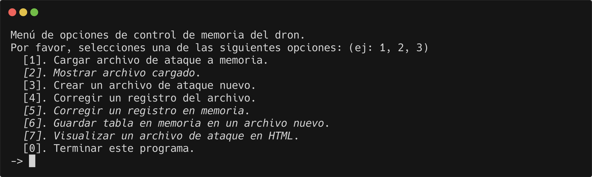

## Índice

* [Integrantes del equipo](#integrantes-del-equipo)
* [Guía de uso](#guía-de-uso)
  * [Crear de una tabla de órdenes](#crear-de-una-tabla-de-órdenes)
  * [Cargar una tabla de órdenes](#cargar-una-tabla-de-órdenes)
  * [Mostrar una tablas de órdenes](#mostrar-una-tablas-de-órdenes)
  * [Modificar un registro de una tabla en memoria](#modificar-un-registro-de-una-tabla-en-memoria)
  * [Guardar tabla en memoria en un archivo](#guardar-tabla-en-memoria-en-un-archivo)
  * [Modificar un registro de una tabla en archivo](#modificar-un-registro-de-una-tabla-en-archivo)
  * [Visualizar una tablas de órdenes mediante HTML](#visualizar-una-tablas-de-órdenes-mediante-html)
* [Condiciones de validación de una tabla de órdenes](#condiciones-de-validación-de-una-tabla-de-órdenes)
* [Uso de Inteligencia Artificial](#uso-de-inteligencia-artificial)
* [Agradecimientos](#agradecimientos)
* [Referencias](#referencias)

## Integrantes del equipo

| Equipo             | Legajo    | Rol en el proyecto      |
| ------------------ | --------- | ----------------------- |
| Joaquín Ivo Kainer | 233.968-7 | Desarrollador principal |

## Guía de uso

> [!NOTE]
> Durante las pruebas y desarrollo del programa, y la realización de las capturas de ejemplo, se utilizó una versión modificada del programa para trabajar con tablas de resolución de 5×5.


Al iniciar el programa, nos recibe el menú principal con 7 funciones distintas, identificadas por un número de acceso.

``` console
Menú de opciones de control de memoria del dron.
Por favor, selecciones una de las siguientes opciones: (ej: 1, 2, 3)
  [1]. Cargar archivo de ataque a memoria.
  [2]. Mostrar archivo cargado.
  [3]. Crear un archivo de ataque nuevo.
  [4]. Corregir un registro del archivo.
  [5]. Corregir un registro en memoria.
  [6]. Guardar tabla en memoria en un archivo nuevo.
  [7]. Visualizar un archivo de ataque en HTML.
  [0]. Terminar este programa.
```

Para acceder a cualquiera de las opciones del menú se debe introdir el número correspondiente, o `[0]` para terminar la ejecución.

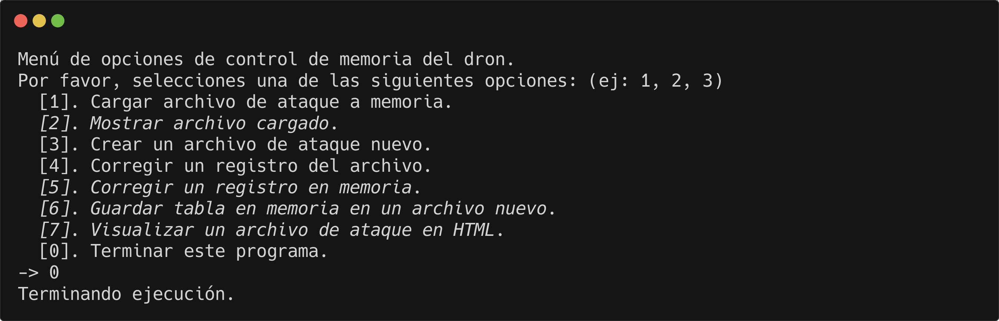

> [!IMPORTANT]
> Apenas iniciado el programa, ciertas opciones del menú están resaltadas en itálica, esto porque se encuentran deshabilitdas ya que son funciones que requieren para su ejecución una tabla de órdenes cargada en memoria.
>
> 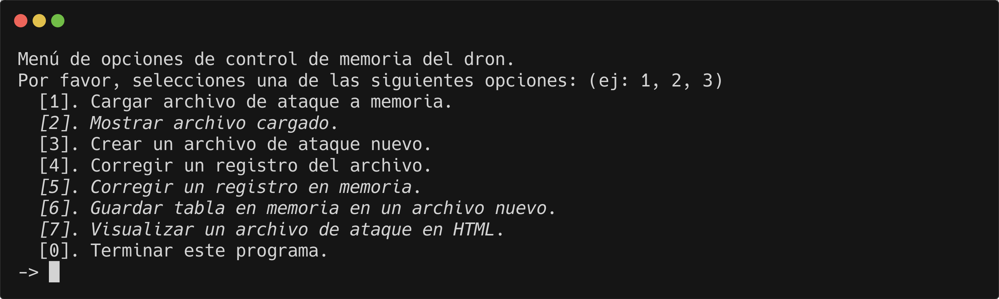
>
> Si se intenta acceder a una de estas opciones sin una tabla cargada, ocurre la siguiente alerta, devolviendo al menú principal de regreso.
>
> 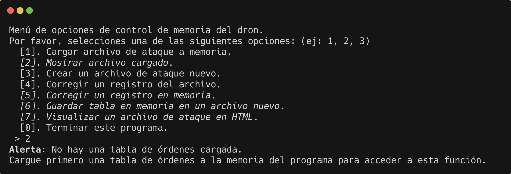

### Crear de una tabla de órdenes

Para crear de una tabla, se accede a la opción `[3]` desde el menú principal.

Uno por uno, el programa solicitará los registros necesarios para poblar las celdas de la tabla.

> [!IMPORTANT]
> El programa recorre la tabla de izquierda a derecha, de arriba a abajo, desde la celda 1×1 hasta la 200×200.


> [!TIP]
> Cuando el programa solicite un valor de "Sí" o "No", `[s/n]`, al responder en blanco presionando la tecla Enter el programa asumirá el valor predeterminado, determinado por la mayúscula en la solicitud de respuesta.
>
> |         | Responde `s`    | Responde `n`    | Responde ` `    |
> | ------- | --------------- | --------------- | --------------- |
> | `[s/N]` | Respuesta = `s` | Respuesta = `n` | Respuesta = `n` |
> | `[S/n]` | Respuesta = `s` | Respuesta = `n` | Respuesta = `s` |

Una vez asignados los valores correspondientes de cada celda de la tabla, el programa procederá a realizar una [validación de los datos](#condiciones-de-validación-de-una-tabla-de-órdenes) ingresados. En caso de que la tabla sea inválida, los cambios realizados se desecharan, y el programa volverá a solicitar los valores de la tabla registro por registro.


El programa solicitará la dirección donde guardar el archivo a crear. Si el archivo ya existe, el programa indicará esto y solicitará como continuar. El usuario podrá elegir si sobreescribir el archivo o elegir otra dirección.

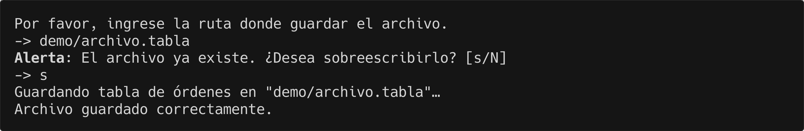


> [!TIP]
> Se recomienda diseñar con antelación la tabla a ingresar en un medio gráfico como papel, ya que el programa presenta una interfaz de texto, y puede resultar difícil de asignar una ruta sin una guía visual de auxilio.

### Cargar una tabla de órdenes

Para cargar una tabla de órdenes a la memoria, se accede a la opción `[1]` desde el menú principal.

El programa solicitará la dirección del archivo donde se almancena la tabla de órdenes.

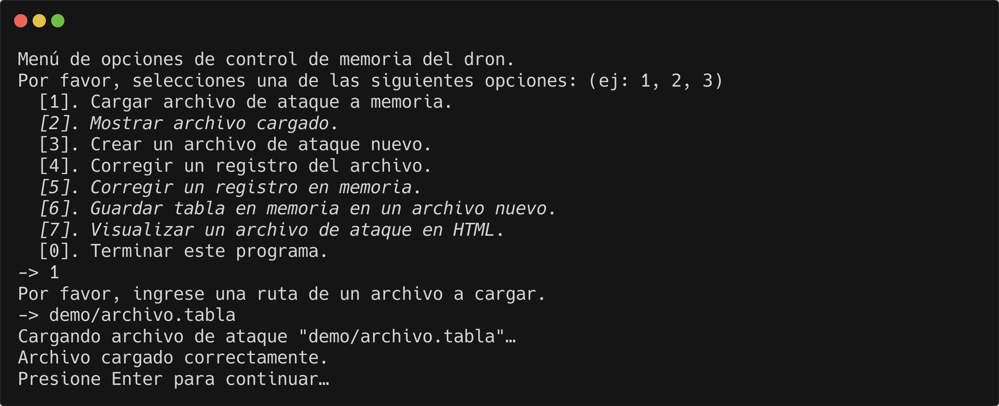

El programa entonces procederá a realizar una [validación de los datos de la tabla](#condiciones-de-validación-de-una-tabla-de-órdenes). En caso de que la tabla sea inválida, el programa volverá a solicitar la dirección de un archivo que contenga una tabla válida.

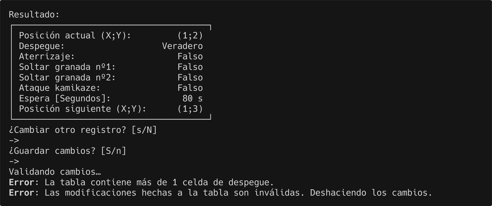

Una vez cargado correctamente el archivo, la tabla que contenía ahora se encuentra almacenada en la memoria del programa. Esto se puede comprobar en el menú principal, que ahora indica el nombre del archivo cargado.


### Mostrar una tablas de órdenes

> [!WARNING]
> Esta función solo está habilitada con una tabla de órdenes ya cargada en memoria. De lo contrario, acceder a ella devolverá una alerta.
>
> 

Para visualizar los registros que componen a una tabla de órdenes cargada previamente en memoria, se accede a la opción `[2]` desde el menú principal.

El programa mostrará los contenidos de cada registro de la tabla cargada de izquierda a derecha, de arriba a abajo, desde la celda 1×1 hasta la 200×200.

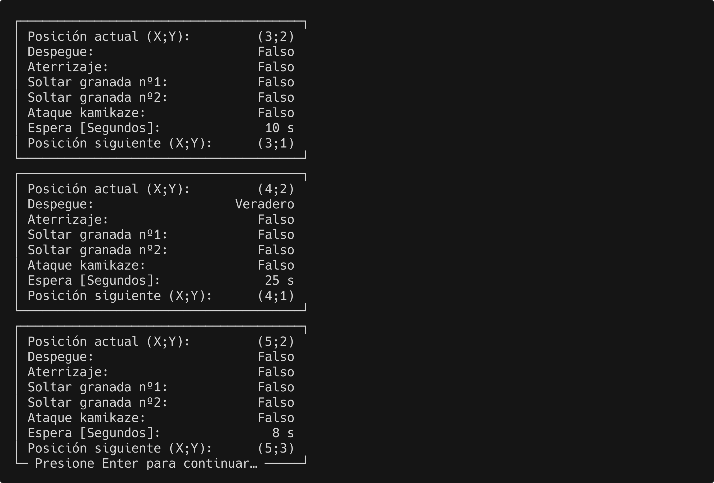

Una vez finalizado el recorrido, el programa volverá al menú principal.

### Modificar un registro de una tabla en memoria

> [!WARNING]
> Esta función solo está habilitada con una tabla de órdenes ya cargada en memoria. De lo contrario, acceder a ella devolverá una alerta.
>
> 

Para modificar un registro de una tabla de órdenes cargada previamente en memoria, se accede a la opción `[5]` desde el menú principal.

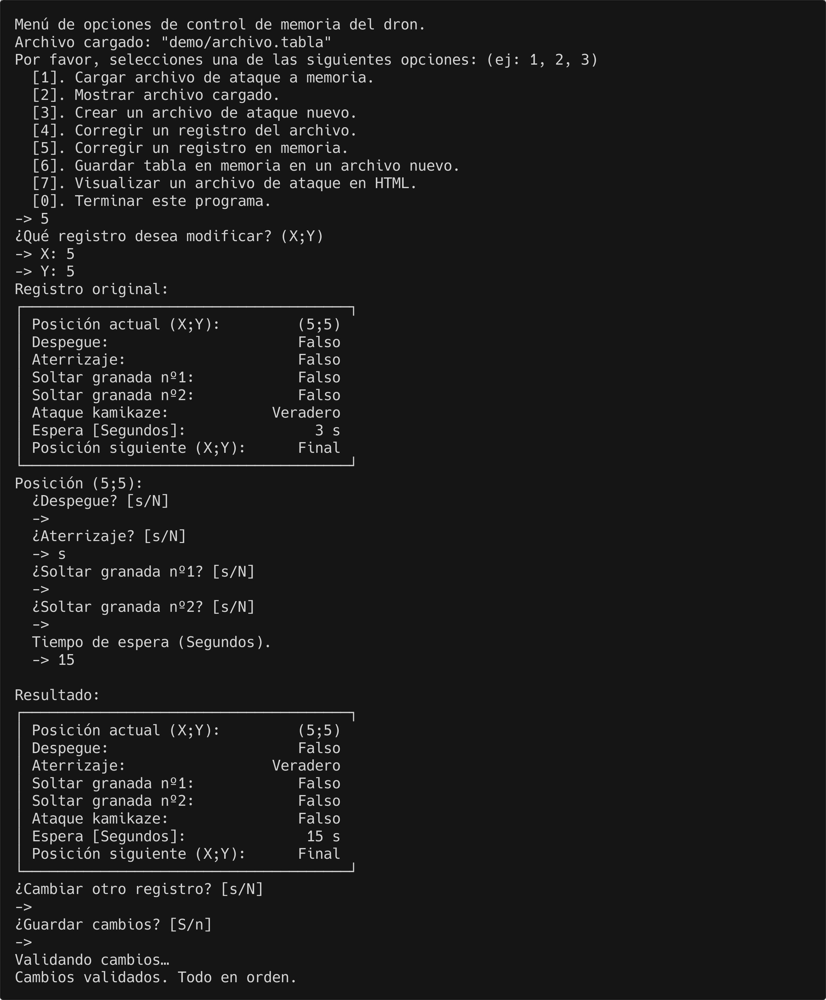

El programa solicitará las coordenadas de la celda a modificar. Una vez elegida la celda, se mostrará por pantalla el registro original.

Aplicados los cambios respectivos, el programa mostrará el registro con los cambios hechos, y solicitará como continuar.

El usuario puede elegir si modificar otro registro. Entonces, el programa solicitará las coordenadas de la celda nueva, y se repetirá el proceso.

Una vez finalizados los cambios, el programa solicitará si guardar los cambios ejercidos en el archivo. Entonces, el programa entonces procederá a realizar una [validación de los datos de la tabla](#condiciones-de-validación-de-una-tabla-de-órdenes) con los nuevos cambios aplicados. En caso de que los cambios sean inválidos, el programa desechará los cambios hechos, volviendo al menú principal.


Con los cambios validados, la tabla modificada se guardará en la memoria del programa.

> [!IMPORTANT]
> El programa indicará que se han realizado cambios a la tabla de órdenes sin guardar en el menú principal con el nombre del archivo cargado en itálica y con un asterisco hasta que se guarden los datos.
>
> 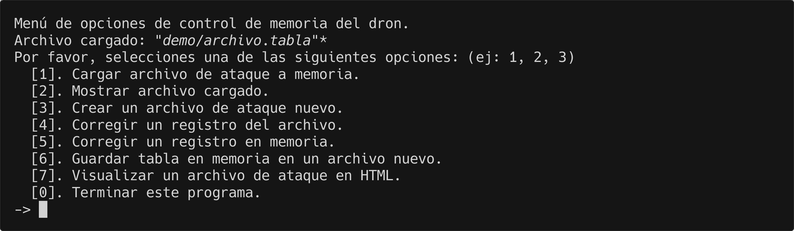

### Guardar tabla en memoria en un archivo

> [!WARNING]
> Esta función solo está habilitada con una tabla de órdenes ya cargada en memoria. De lo contrario, acceder a ella devolverá una alerta.
>
> 

Para guardar una tabla de órdenes en memoria en un archivo, se accede a la opción `[6]` desde el menú principal.

El programa solicitará la dirección donde guardar el archivo a crear. Si el archivo ya existe, el programa indicará esto y solicitará como continuar. El usuario podrá elegir si sobreescribir el archivo o elegir otra dirección.


### Modificar un registro de una tabla en archivo

Para modificar un registro de una tabla de órdenes de un archivo, se accede a la opción `[4]` desde el menú principal.

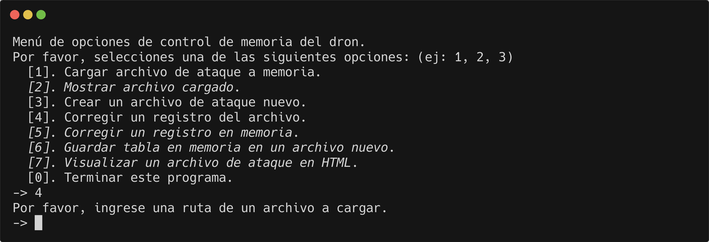

El programa solicitará las coordenadas de la celda a modificar. Una vez elegida la celda, se mostrará por pantalla el registro original.

Aplicados los cambios respectivos, el programa mostrará el registro con los cambios hechos, y solicitará como continuar.

El usuario puede elegir si modificar otro registro. Entonces, el programa solicitará las coordenadas de la celda nueva, y se repetirá el proceso.

Una vez finalizados los cambios, el programa solicitará si guardar los cambios ejercidos en el archivo. Entonces, el programa entonces procederá a realizar una [validación de los datos de la tabla](#condiciones-de-validación-de-una-tabla-de-órdenes) con los nuevos cambios aplicados. En caso de que los cambios sean inválidos, el programa desechará los cambios hechos, volviendo al menú principal.


Con los cambios validados, la tabla modificada se guardará en el archivo original, sobreescribiendo los registros originales.

### Visualizar una tablas de órdenes mediante HTML

> [!WARNING]
> Esta función solo está habilitada con una tabla de órdenes ya cargada en memoria. De lo contrario, acceder a ella devolverá una alerta.
>
> 

Para visualizar una tabla de órdenes en memoria mediante una página HTML, se accede a la opción `[7]` desde el menú principal.

El programa generará entonces una página web HTML en el directorio del archivo cargado.

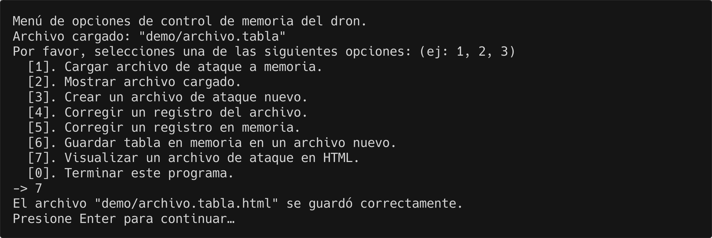

Se puede acceder a este archivo HTML con cualquier navegador moderno.

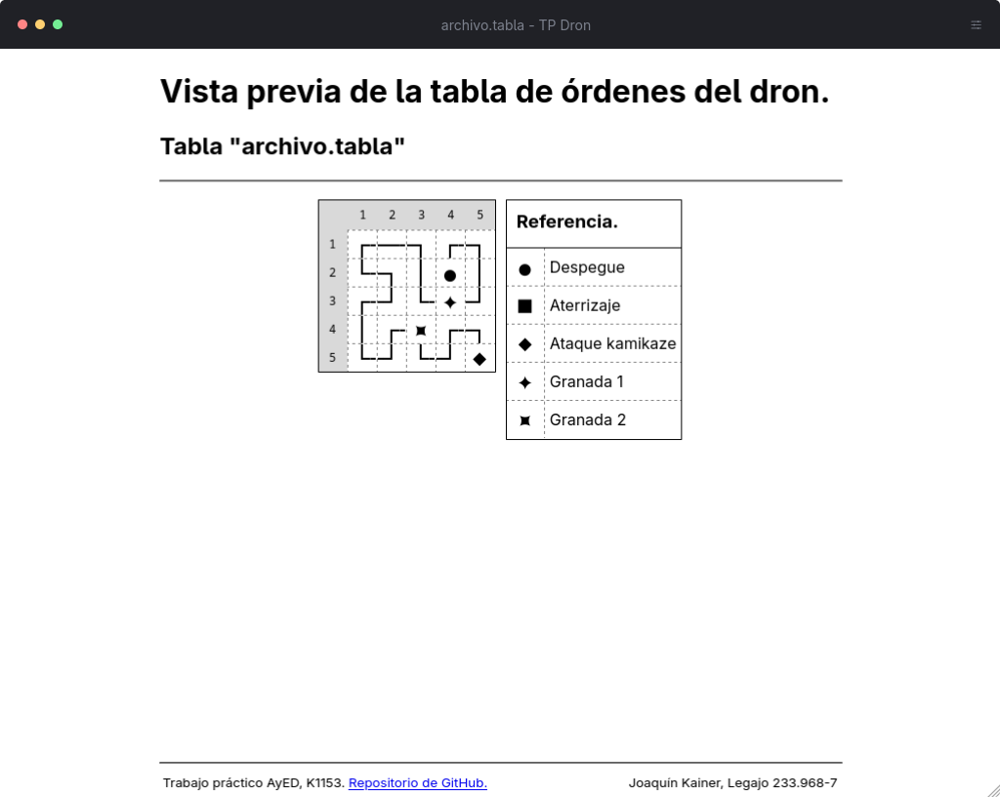

## Condiciones de validación de una tabla de órdenes

La lista de condiciones que una tabla debe cumplir para ser reconocida como válida son las siguientes:

* Tener exactamente 1 celda de despegue.
  * Una celda de despegue no puede contener ninguna otra instrucción.
* Tener exactamente 1 celda de finalización (Aterrizaje o kamikaze).
  * No tener simultaneamente una celda de aterrizaje y una de ataque kamikaze.
* Ser recorrida en su totalidad desde la celda de despegue hasta la de finalización.
  * Recorrer cada celda de la tabla exactamente 1 vez.
  * No recorrer celdas fuera de los limites ( ≤0 o >200 ).
  * Solo recorrer celdas adyacentes unas de otras.
* Tener no más de 1 celda de granada nº1 y 1 de granada nº2.

En caso de no cumplir tan solo una de estas condiciones, el programa tachará de inválida la tabla, resultando en un error.

## Desarrollo del programa

…

## Uso de Inteligencia Artificial

Si bien cada día la inteligencia artificial demuestra ser una herramienta cada vez más poderosa y (…), el equipo tomó la decisión de __no__ utilizarla en lo absoluto durante el desarrollo de este proyecto.

Consideramos que en una etapa de formación y desarrollo como es un trabajo práctico para un organismo académico como es la universidad, se castiga no solo con la reducción de oportunidades para aplicar y entrenar la habilidad de resolución de problemas, habilidad fundamental en y para una ingeniería, sino tambien la de la incerteza e falibilidad fundamentalmente ligadas a todo modelo generativo de lenguaje (LLM) por su mismo diseño.

Al implementar código generado de manera artificial, se reduce su comprención fundamental en el desarrollador que, en vez de redactarlo, se rebaja a reseñarlo, ya que está delegando el proceso cognitivo fundamentalmente ligado a diseñar un sistema a una máquina y solo ve el resultado ya funcional.
Esto desliga al diseñador a un mero espectador de un sistema ya funcional cuyo comportamiento comprende, mas no la razón del porque, ya que no ha reflexionado en sus implementaciones alternativas.

Parte de diseñar es tomar decisiones deliberadas, valorando multiples opciones dados un caso y seleccionando el más adecuado según una serie de preceptos deliberados por el juicio del desarrollador.

Las inteligencias artificiales parecen ocupar cada vez más espacio en la vida cotidiana y profesional, con o sin la aprobación de a quienes se les implementa, pero este resultó no ser un momento adecuado para dicha implementación.

Debido a este y múltiples motivos personales que no tienen lugar aquí, se llegó a la decisión de __nulo empleo__.

## Agradecimientos

Se agradece cordialmente a Roxana Dabusti y Deix Surita por la ayuda proporcionada y el feedback al ofrecerse a probar el programa en busca de errores críticos al momento de su ejecución durante etapas de desarrollo.

## Referencias

[Manufacturer’s Guide to Developing Consumer Product Instructions - Timothy P. Smith](https://www.cpsc.gov/s3fs-public/pdfs/guide.pdf)
