# Trabajo Práctico - Algoritmos y Estructura de Datos K1153

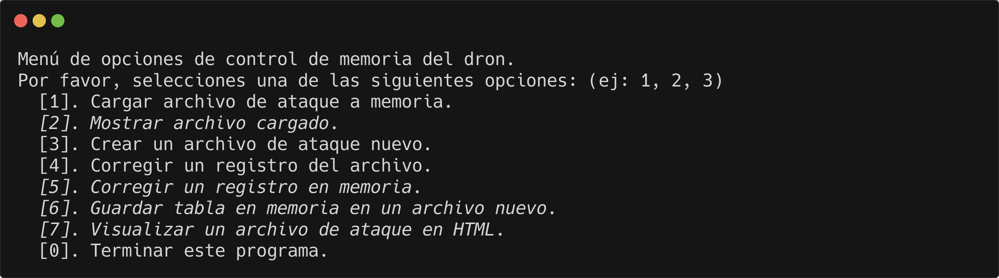
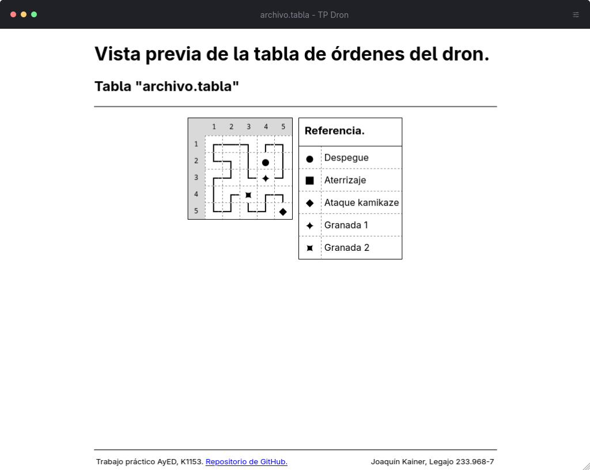

## Índice

* [Integrantes del equipo](#integrantes-del-equipo)
* [Guía de uso](#guía-de-uso)
  * [Crear de una tabla de órdenes](#crear-de-una-tabla-de-órdenes)
  * [Cargar una tabla de órdenes](#cargar-una-tabla-de-órdenes)
  * [Mostrar una tablas de órdenes](#mostrar-una-tablas-de-órdenes)
  * [Modificar un registro de una tabla en memoria](#modificar-un-registro-de-una-tabla-en-memoria)
  * [Guardar tabla en memoria en un archivo](#guardar-tabla-en-memoria-en-un-archivo)
  * [Modificar un registro de una tabla en archivo](#modificar-un-registro-de-una-tabla-en-archivo)
  * [Visualizar una tablas de órdenes mediante HTML](#visualizar-una-tablas-de-órdenes-mediante-html)
* [Condiciones de validación de una tabla de órdenes](#condiciones-de-validación-de-una-tabla-de-órdenes)
* [Fucionamiento y desarrollo del programa](#funcionamiento-y-desarrollo-del-programa)
  * [_Lista a tabla_ y _Tabla a lista_](#lista-a-tabla-y-tabla-a-lista)
  * [_Clonar tabla_](#clonar-tabla)
  * [_Bucle principal_](#bucle-principal)
  * [_Cargar archivo_](#cargar-archivo)
  * [_Mostrar tabla_](#mostrar-tabla)
  * [_Crear ataque_](#crear-ataque)
  * [_Modificar registro_](#modificar-registro)
  * [_Modificar registro de archivo_](#modificar-registro-de-archivo)
  * [_Guardar ataque_](#guardar-ataque)
  * [_Crear HTML_](#crear-html)
* [Uso de Inteligencia Artificial](#uso-de-inteligencia-artificial)
* [Agradecimientos](#agradecimientos)
* [Referencias](#referencias)

## Integrantes del equipo

| Equipo             | Legajo    | Rol en el proyecto      |
| ------------------ | --------- | ----------------------- |
| Joaquín Ivo Kainer | 233.968-7 | Desarrollador principal |

## Guía de uso

> [!NOTE]
> Durante las pruebas y desarrollo del programa, y la realización de las capturas de ejemplo, se utilizó una versión modificada del programa para trabajar con tablas de resolución de 5×5.

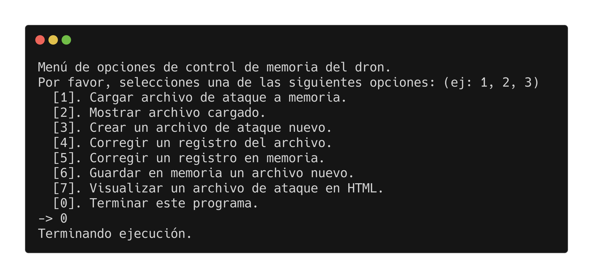

Al iniciar el programa, nos recibe el menú principal con 7 funciones distintas, identificadas por un número de acceso.

Para acceder a cualquiera de las opciones del menú se debe introdir el número correspondiente, o `[0]` para terminar la ejecución.

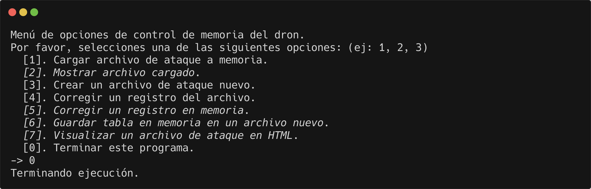

> [!IMPORTANT]
> Apenas iniciado el programa, ciertas opciones del menú están resaltadas en itálica, esto porque se encuentran deshabilitdas ya que son funciones que requieren para su ejecución una tabla de órdenes cargada en memoria.
>
> 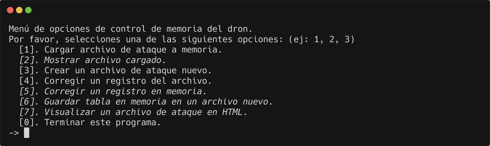
>
> Si se intenta acceder a una de estas opciones sin una tabla cargada, ocurre la siguiente alerta, devolviendo al menú principal de regreso.
>
> 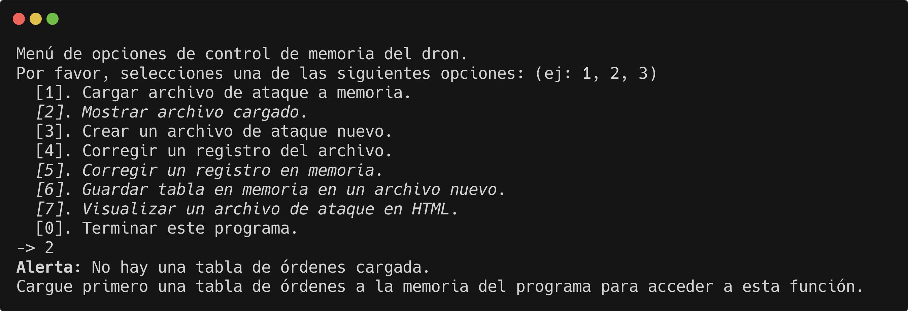

### Crear de una tabla de órdenes

Para crear de una tabla, se accede a la opción `[3]` desde el menú principal.

Uno por uno, el programa solicitará los registros necesarios para poblar las celdas de la tabla.

> [!IMPORTANT]
> El programa recorre la tabla de izquierda a derecha, de arriba a abajo, desde la celda 1×1 hasta la 200×200.

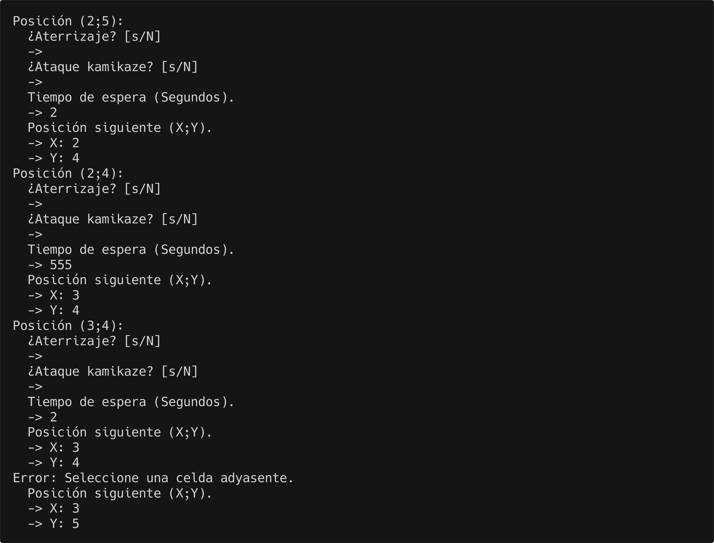

> [!TIP]
> Cuando el programa solicite un valor de "Sí" o "No", `[s/n]`, al responder en blanco presionando la tecla Enter el programa asumirá el valor predeterminado, determinado por la mayúscula en la solicitud de respuesta.
>
> |         | Responde `s`    | Responde `n`    | Responde ` `    |
> | ------- | --------------- | --------------- | --------------- |
> | `[s/N]` | Respuesta = `s` | Respuesta = `n` | Respuesta = `n` |
> | `[S/n]` | Respuesta = `s` | Respuesta = `n` | Respuesta = `s` |

Una vez asignados los valores correspondientes de cada celda de la tabla, el programa procederá a realizar una [validación de los datos](#condiciones-de-validación-de-una-tabla-de-órdenes) ingresados.

El programa solicitará la dirección donde guardar el archivo a crear. Si el archivo ya existe, el programa indicará esto y solicitará como continuar. El usuario podrá elegir si sobreescribir el archivo o elegir otra dirección.

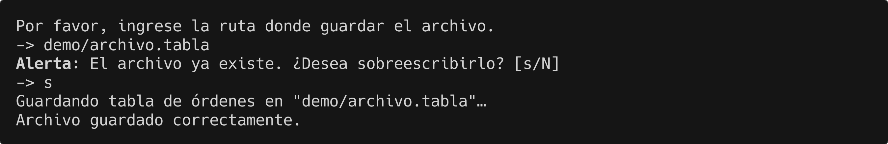

> [!TIP]
> Se recomienda diseñar con antelación la tabla a ingresar en un medio gráfico como papel, ya que el programa presenta una interfaz de texto, y puede resultar difícil de asignar una ruta sin una guía visual de auxilio.

### Cargar una tabla de órdenes

Para cargar una tabla de órdenes a la memoria, se accede a la opción `[1]` desde el menú principal.

El programa solicitará la dirección del archivo donde se almancena la tabla de órdenes.

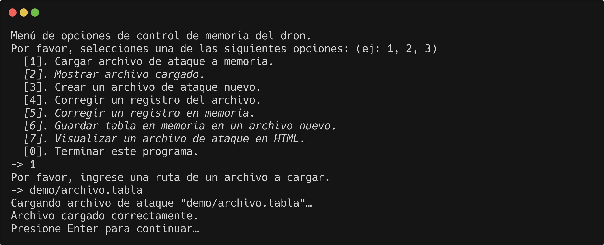

El programa entonces procederá a realizar una [validación de los datos de la tabla](#condiciones-de-validación-de-una-tabla-de-órdenes). En caso de que la tabla sea inválida, el programa volverá a solicitar la dirección de un archivo que contenga una tabla válida.

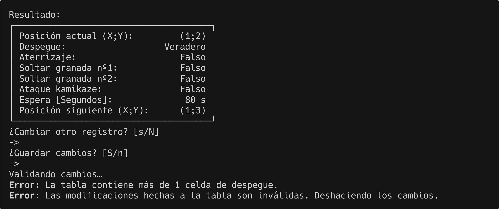

Una vez cargado correctamente el archivo, la tabla que contenía ahora se encuentra almacenada en la memoria del programa. Esto se puede comprobar en el menú principal, que ahora indica el nombre del archivo cargado.


### Mostrar una tablas de órdenes

> [!WARNING]
> Esta función solo está habilitada con una tabla de órdenes ya cargada en memoria. De lo contrario, acceder a ella devolverá una alerta.
>
> 

Para visualizar los registros que componen a una tabla de órdenes cargada previamente en memoria, se accede a la opción `[2]` desde el menú principal.

El programa mostrará los contenidos de cada registro de la tabla cargada de izquierda a derecha, de arriba a abajo, desde la celda 1×1 hasta la 200×200.

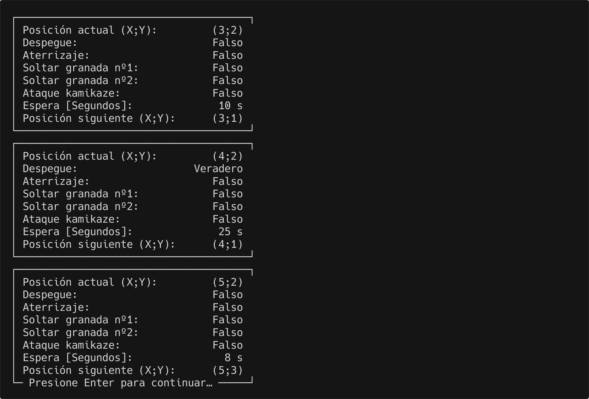

Una vez finalizado el recorrido, el programa volverá al menú principal.

### Modificar un registro de una tabla en memoria

> [!WARNING]
> Esta función solo está habilitada con una tabla de órdenes ya cargada en memoria. De lo contrario, acceder a ella devolverá una alerta.
>
> 

Para modificar un registro de una tabla de órdenes cargada previamente en memoria, se accede a la opción `[5]` desde el menú principal.

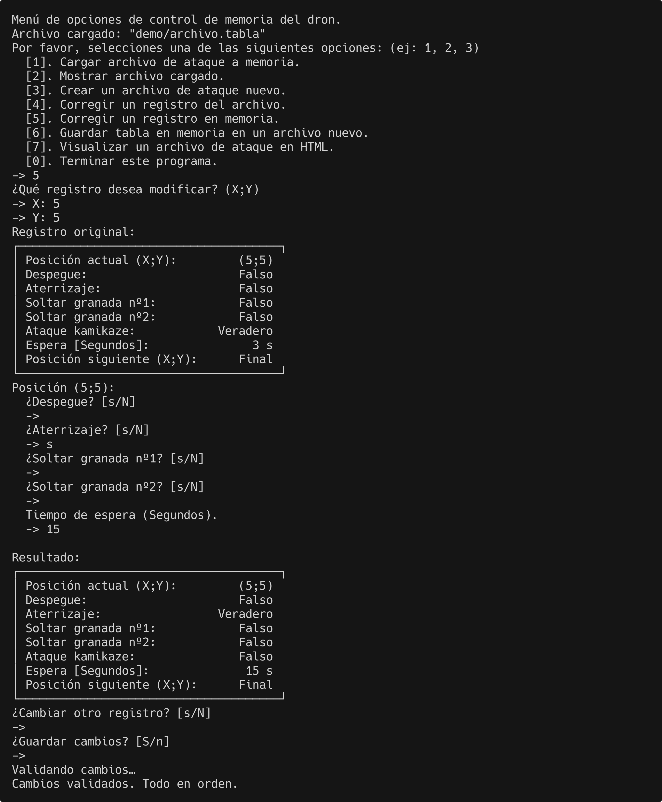

El programa solicitará las coordenadas de la celda a modificar. Una vez elegida la celda, se mostrará por pantalla el registro original.

Aplicados los cambios respectivos, el programa mostrará el registro con los cambios hechos, y solicitará como continuar.

El usuario puede elegir si modificar otro registro. Entonces, el programa solicitará las coordenadas de la celda nueva, y se repetirá el proceso.

Una vez finalizados los cambios, el programa solicitará si guardar los cambios ejercidos en el archivo. Entonces, el programa entonces procederá a realizar una [validación de los datos de la tabla](#condiciones-de-validación-de-una-tabla-de-órdenes) con los nuevos cambios aplicados. En caso de que los cambios sean inválidos, el programa desechará los cambios hechos, volviendo al menú principal.


Con los cambios validados, la tabla modificada se guardará en la memoria del programa.

> [!IMPORTANT]
> El programa indicará que se han realizado cambios a la tabla de órdenes sin guardar en el menú principal con el nombre del archivo cargado en itálica y con un asterisco hasta que se guarden los datos.
>
> 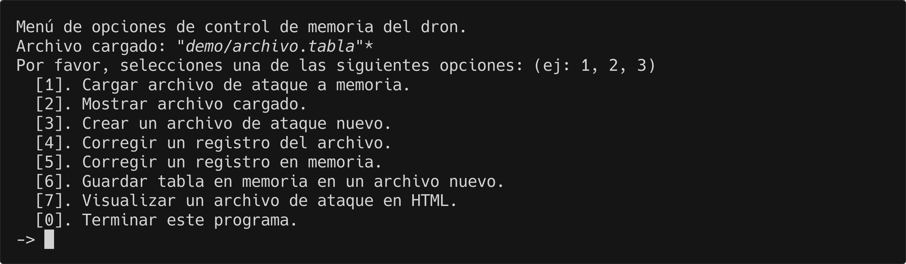

### Guardar tabla en memoria en un archivo

> [!WARNING]
> Esta función solo está habilitada con una tabla de órdenes ya cargada en memoria. De lo contrario, acceder a ella devolverá una alerta.
>
> 

Para guardar una tabla de órdenes en memoria en un archivo, se accede a la opción `[6]` desde el menú principal.

El programa solicitará la dirección donde guardar el archivo a crear. Si el archivo ya existe, el programa indicará esto y solicitará como continuar. El usuario podrá elegir si sobreescribir el archivo o elegir otra dirección.


### Modificar un registro de una tabla en archivo

Para modificar un registro de una tabla de órdenes de un archivo, se accede a la opción `[4]` desde el menú principal.

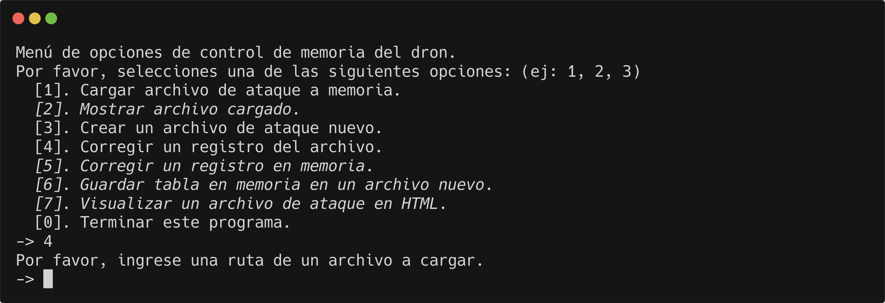

El programa solicitará las coordenadas de la celda a modificar. Una vez elegida la celda, se mostrará por pantalla el registro original.

Aplicados los cambios respectivos, el programa mostrará el registro con los cambios hechos, y solicitará como continuar.

El usuario puede elegir si modificar otro registro. Entonces, el programa solicitará las coordenadas de la celda nueva, y se repetirá el proceso.

Una vez finalizados los cambios, el programa solicitará si guardar los cambios ejercidos en el archivo. Entonces, el programa entonces procederá a realizar una [validación de los datos de la tabla](#condiciones-de-validación-de-una-tabla-de-órdenes) con los nuevos cambios aplicados. En caso de que los cambios sean inválidos, el programa desechará los cambios hechos, volviendo al menú principal.


Con los cambios validados, la tabla modificada se guardará en el archivo original, sobreescribiendo los registros originales.

### Visualizar una tablas de órdenes mediante HTML

> [!WARNING]
> Esta función solo está habilitada con una tabla de órdenes ya cargada en memoria. De lo contrario, acceder a ella devolverá una alerta.
>
> 

Para visualizar una tabla de órdenes en memoria mediante una página HTML, se accede a la opción `[7]` desde el menú principal.

El programa generará entonces una página web HTML en el directorio del archivo cargado.

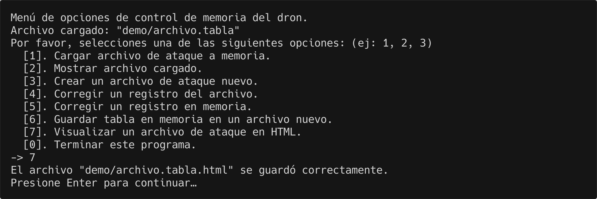

Se puede acceder a este archivo HTML con cualquier navegador moderno.


## Condiciones de validación de una tabla de órdenes

La lista de condiciones que una tabla debe cumplir para ser reconocida como válida son las siguientes:

* Tener exactamente 1 celda de despegue.
  * Una celda de despegue no puede contener ninguna otra instrucción.
* Tener exactamente 1 celda de finalización (Aterrizaje o kamikaze).
  * No tener simultaneamente una celda de aterrizaje y una de ataque kamikaze.
* Ser recorrida en su totalidad desde la celda de despegue hasta la de finalización.
  * Recorrer cada celda de la tabla exactamente 1 vez.
  * No recorrer celdas fuera de los limites ( ≤0 o >200 ).
  * Solo recorrer celdas adyacentes unas de otras.
* Tener no más de 1 celda de granada nº1 y 1 de granada nº2.

En caso de no cumplir tan solo una de estas condiciones, el programa tachará de inválida la tabla, resultando en un error.

## Funcionamiento y desarrollo del programa

### _Lista a tabla_ y _Tabla a lista_

```cpp
// Copia el contenido de una lista de prototipo "OrdenArchivo"
// a una tabla en memoria de prototipo "Orden".
void listaATabla(
  OrdenArchivo lista[TABLA_TAMANO_X * TABLA_TAMANO_Y],
  Orden tabla[TABLA_TAMANO_X][TABLA_TAMANO_Y]
) {
  int x, y;
  for (int i = 0; i < TABLA_TAMANO_X * TABLA_TAMANO_Y; i++) {
    x = lista[i].x;
    y = lista[i].y;

    tabla[x][y].despegue        = lista[i].despegue;
    tabla[x][y].aterrizaje      = lista[i].aterrizaje;
    tabla[x][y].soltar_granada1 = lista[i].soltar_granada1;
    tabla[x][y].soltar_granada2 = lista[i].soltar_granada2;
    tabla[x][y].ataque_kamikaze = lista[i].ataque_kamikaze;
    tabla[x][y].espera          = lista[i].espera;
    tabla[x][y].siguiente_x     = lista[i].siguiente_x;
    tabla[x][y].siguiente_y     = lista[i].siguiente_y;
  }

  return;
}
```

```cpp
// Copia el contenido de una tabla en memoria de prototipo "Orden"
// a una lista de prototipo "OrdenArchivo".
void tablaALista(
  OrdenArchivo lista[TABLA_TAMANO_X * TABLA_TAMANO_Y],
  Orden tabla[TABLA_TAMANO_X][TABLA_TAMANO_Y]
) {
  int i = 0;
  for (int y = 0; y < TABLA_TAMANO_Y; y++) {
    for (int x = 0; x < TABLA_TAMANO_X; x++) {
      lista[i].x = x;
      lista[i].y = y;

      lista[i].despegue        = tabla[x][y].despegue;
      lista[i].aterrizaje      = tabla[x][y].aterrizaje;
      lista[i].soltar_granada1 = tabla[x][y].soltar_granada1;
      lista[i].soltar_granada2 = tabla[x][y].soltar_granada2;
      lista[i].ataque_kamikaze = tabla[x][y].ataque_kamikaze;
      lista[i].espera          = tabla[x][y].espera;
      lista[i].siguiente_x     = tabla[x][y].siguiente_x;
      lista[i].siguiente_y     = tabla[x][y].siguiente_y;
      i++;
    }
  }

  return;
}
```

El par de procedimientos `listaATabla()` y `tablaALista()` tienen por función el de poblar los registros de una lista dada por parámetro a una tabla también dada por parámetro y viseversa.

---

### _Clonar tabla_

```cpp
// Copia el contenido de una tabla de órdenes "Original" a otra "Copia".
void clonarTabla(
  Orden original[TABLA_TAMANO_X][TABLA_TAMANO_Y],
  Orden copia[TABLA_TAMANO_X][TABLA_TAMANO_Y]
) {
  // Podría usar un solo bucle For y aritmética de punteros para transitar
  // las tablas, pero en pro de la legibilidad, prefiero recorrerlo en
  // ambos ejes por separado con dos bucles.
  for (int y = 0; y < TABLA_TAMANO_Y; y++) {
    for (int x = 0; x < TABLA_TAMANO_X; x++) {
      copia[x][y] = original[x][y];
    }
  }

  return;
}
```

Esta función copia el contenido de una tabla dada por parámetro a otra también dada por parámetro registro a registro.

---

### _Bucle principal_

El programa se ejecuta bajo un bucle principal, que comienza mostrando en pantalla el "menú principal", y solicitando al usuario un valor numérico.

```cpp
// Menú principal.
void bucleMenu(
  Orden tabla[TABLA_TAMANO_X][TABLA_TAMANO_Y],
  bool &flag_tabla_cargada, bool &flag_tabla_modificada,
  char direccion_archivo[RUTA_MAX]
) {
  int eleccion = -1;

  while (eleccion != 0) {
    // Con esta comparación se evita reimprimir el menú si
    // la opción ingresada es incorrecta, pero sí si se
    // acaba de salir de una opción real luego de utilizarla.
    if (eleccion < 8) {
      //cout << endl;
      cout << "Menú de opciones de control de memoria del dron." << endl;
      if (flag_tabla_cargada) {
        cout << "Archivo cargado: ";
        if (flag_tabla_modificada) cout << ANSI_ITALICS;
        cout << "\"" << direccion_archivo << "\"";
        // Se agrega un asterisco para denotar de manera visual que
        // se realizaron cambios a la tabla en memoria.
        if (flag_tabla_modificada) cout << ANSI_CLEAR << "*";
        cout << endl;
      }
      cout << "Por favor, selecciones una de las siguientes opciones: (ej: 1, 2, 3)" << endl;

      cout << "  [1]. Cargar archivo de ataque a memoria." << endl;

      if (!flag_tabla_cargada) cout << ANSI_ITALICS;
      // La idea es que en caso de no tener cargada en memoria un archivo
      // indicar visualmente que la opción no es accesible.
      cout << "  [2]. Mostrar archivo cargado." << ANSI_CLEAR << endl;

      cout << "  [3]. Crear un archivo de ataque nuevo." << endl;

      cout << "  [4]. Corregir un registro del archivo." << endl;

      if (!flag_tabla_cargada) cout << ANSI_ITALICS;
      cout << "  [5]. Corregir un registro en memoria." << ANSI_CLEAR << endl;

      if (!flag_tabla_cargada) cout << ANSI_ITALICS;
      cout << "  [6]. Guardar tabla en memoria en un archivo nuevo." << ANSI_CLEAR << endl;

      if (!flag_tabla_cargada) cout << ANSI_ITALICS;
      cout << "  [7]. Visualizar un archivo de ataque en HTML." << ANSI_CLEAR << endl;

      cout << "  [0]. Terminar este programa." << endl;
    }

    cout << CURSOR;
    cin >> eleccion;
    if (cinInvalido()) {
      eleccion = 8;
      continue;
    }
    // Se utiliza cin.ignore() para prevenir error de leading whitespace al presionar Enter.
    // Este comportamiento se puede obtener utilizando cin.get(), pero se decidió por
    // usar cin.ignore() ya que el valor obtenido no va a ser almacenado.
    cin.ignore();
    switch (eleccion) {
      default:
        cout << ERROR; // MSG_ERROR
        cout << "Opción no valida. Vuelva a intentarlo." << endl;
        break;
      case 0:
        cout << "Terminando ejecución." << endl;
        break;
      case 1: // Cargar archivo de ataque.
        cargarArchivo(tabla, direccion_archivo);
        flag_tabla_cargada = true;
        flag_tabla_modificada = false;
        break;
      case 2: // Mostrar archivo cargado.
        if (!comprobarTablaCargada(flag_tabla_cargada)) break;
        mostrarTabla(tabla);
        break;
      case 3: // Crear archivo de ataque nuevo y poblarlo.
        crearAtaque();
        break;
      case 4: // Modificar tabla en archivo.
        modificarRegistroDeArchivo();
        break;
      case 5: // Modificar tabla en memoria.
        if (!comprobarTablaCargada(flag_tabla_cargada)) break;
        flag_tabla_modificada = modificarRegistro(tabla);
        break;
      case 6: // Guardar archivo de ataque.
        if (!comprobarTablaCargada(flag_tabla_cargada)) break;
        guardarAtaque(tabla, direccion_archivo);
        flag_tabla_modificada = false;
        break;
      case 7: // Crear página HTML.
        if (!comprobarTablaCargada(flag_tabla_cargada)) break;
        crearHTML(tabla, direccion_archivo);
        break;
    }
  }

  return;
}
```

Se utilizan _secuencias ANSI_ en multiples puntos para comunicarle al emulador de terminal donde aplicar ciertos cambios estéticos, como `ANSI_ITALICS`, para denotar que cuando la _tabla_ `tabla[TABLA_TAMANO_X][TABLA_TAMANO_Y]` está vacía, según el _flag_ `flag_tabla_cargada`, dichas opciones no están disponibles para la ejecución.

```cpp
#define ANSI_ITALICS "\033[3m" // Código ANSI para Italics.
#define ANSI_CLEAR "\033[0m"
#define ANSI_LINEA_ANTERIOR "\033[F" // Mover el cursor de la terminal al inicio de la linea anterior.
#define ERROR "\033[1mError\033[0m: " // "Error:" con el código ANSI de negrita.
#define WARN "\033[1mAlerta\033[0m: "
```

Luego de solicitar un valor numérico para seleccionar a una de las 7 opciones accesibles desde el menú principal, se accede al procedimiento `cinInvalido()`, que comprueba que el valor solicitado sea efectivamente uno numérico.

```cpp
    if (cinInvalido()) {
      eleccion = 8;
      continue;
    }
```

```cpp
// Comprueba que se se haya ingresado un valor válido. En caso de que
// "cin" devuelva error, limpia el estado de error y devuelve "true".
bool cinInvalido() {
  if (!cin) {
    cout << ERROR; // MSG_ERROR
    cout << "Respuesta no valida. Vuelva a intentarlo." << endl;
    cin.clear();
    // Limpio el buffer de entrada completo, evitando que si se ingresaron
    // multiples caracteres, se ignoren todos y no solo el primero.
    cin.ignore(std::numeric_limits<std::streamsize>::max(), '\n');
    return true;
  }

  return false;
}
```

Este procedimiento valida el valor de `cin`, que retorna un error en caso de un valor inesperado en su ingreso, como puede ser un caracter cuando se solicita uno numérico. En caso de que se encuentre en un estado de error, se utiliza `cin.clear()` para reiniciar ese estado de error al normal, y se ignora la totalidad de los valores ingresador por `cin`, mostrando por pantalla un mensaje de error y finalmente retornando `true`, para indicarle al programa principal que se debe volver a solicitar un valor.

```cpp
      case 7: // Crear página HTML.
        if (!comprobarTablaCargada(flag_tabla_cargada)) break;
        crearHTML(tabla, direccion_archivo);
        break;
```

En las funciones del programa que requieren de que la _tabla_ `tabla[TABLA_TAMANO_X][TABLA_TAMANO_Y]` tenga registros válidos en su interior, se accede a la función `comprobarTablaCargada(flag_tabla_cargada)`;

```cpp
// Imprime un error y retorna "false" cuando no hay una tabla de
// órdenes cargada en memoria. Retorna "true" en caso contrario.
bool comprobarTablaCargada(bool flag) {
  if (!flag) {
    cout << WARN; // MSG_WARN
    cout << "No hay una tabla de órdenes cargada." << endl;
    cout << "Cargue primero una tabla de órdenes a la memoria del programa para acceder a esta función." << endl;
    return false;
  }

  return true;
}
```

Que valida el _flag_ `flag_tabla_cargada`, y devuelve `false` en caso de que el flag sea `false`, junto a un mensaje de alerta por pantalla.

---

### _Cargar archivo_

Como explico en el comentario, durante la totalidad del proyecto, utilizo la sentencia `while ()` de manera inversa a la intencionada, sin un valor de salida de bucle, sinó que invierto la lógica, utilizando sentencias `if ()` para determinar puntos clave donde volver al inicio del bucle. Esto lo hago tanto por una mejora de legibilidad del código, como por una de granularidad de los mensajes de error.

En vez de llevar pendiente una variable que haga la de flag de salida del bucle, repito de manera instantanea el bucle utilizando la palabra clave `continue` cuando una verificación no se cumple, permitiendome también identificar con exactitud en que momento del proceso se detuvo, pudiendo mostrar por pantalla un error concreto; y saliendo del bucle llegado al final con la palabra clave `break`.

Esta manera inversa de utilizar la sentencia `while ()` me permite granulanizar los mensajes de error y alerta, logrando que estos sean más concretos con las acciones inválidas que puedan estar ocurriendo de parte del usuario, en vez de simplemente anular las acciones del usuario y no dar explicaciones.

```cpp
void cargarArchivo(Orden tabla[TABLA_TAMANO_X][TABLA_TAMANO_Y], char direccion_archivo[RUTA_MAX]){
  OrdenArchivo lista_archivo[TABLA_TAMANO_X * TABLA_TAMANO_Y];

  // Acá estoy usando un While de una manera particular. Generalmente se le pone una
  // condición de salida y se comprueba cada loop, utilizando sentencias
  // selectivas para lograr dicha condición de salida.
  // En este caso ocurre lo contrario, no hay condición de salida y las sentencias
  // selctivas son las que repiten el bucle, pero al llegar al final del bucle
  // se consigue salir por la sentencia Break. Se eligió esta forma por la sencillez y
  // claridad visual de su implementación, ya que permite secuenciar multiples
  // condiciones de salida en sentencias If de manera clara.
  cout << "Por favor, ingrese una ruta de un archivo a cargar." << endl;
  while (true) {
    if (!buscarArchivo(direccion_archivo, 'r')) continue; // Vuelve a empezar el loop while.
    if (!leerArchivo(direccion_archivo, lista_archivo)) continue;
    listaATabla(lista_archivo, tabla);
    if (!validarTabla(tabla)) continue;
    // El mensaje de "archivo guardardo" está acá y no en "leerArchivo()" porque
    // se debe mostrar posterior a la comprovación de validez.
    cout << "Archivo cargado correctamente." << endl;
    cout << "Presione Enter para continuar… "; // MSG_SUCCESS
    cin.ignore();
    break;
  }

  return;
}
```

Para cargar un archivo _tabla de órdenes_ a la memoria, se llevan a cabo una serie de comprobaciones. En primer lugar, se accede al procedimiento `buscarArchivo(direccion_archivo, 'r')`:

```cpp
// Comprueba la existencia de un archivo en una dirección dada.
// Retorna "false" si no existe.
bool buscarArchivo(char direccion_archivo[RUTA_MAX], char modo) {
  FILE *archivo;
  int tamaño_archivo = 0;
  char respuesta = '\0';

  cout << CURSOR;
  cin.getline(direccion_archivo, RUTA_MAX);
  //cin >> direccion_archivo;

  switch (modo) {
    case 'r':
      if (!(archivo = fopen(direccion_archivo, "r"))) {
        cout << ERROR; // MSG_ERROR
        cout << "La dirección del archivo ingresada es inválida o el archivo no existe. ";
        cout << "Por favor, vuelva a intentarlo o ingrese una ruta válida." << endl;
        return false;
      }

      fseek(archivo, 0, SEEK_END);
      tamaño_archivo = ftell(archivo) / sizeof(OrdenArchivo); // Tamaño del archivo en celdas.
      if (tamaño_archivo != TABLA_TAMANO_X * TABLA_TAMANO_Y) {
        cout << ERROR; // MSG_ERROR
        cout << "El archivo cargado tiene un tamaño invalido. ";
        cout << "Por favor, ingrese un archivo de ataque válido." << endl;
        fclose(archivo);
        return false;
      }
      fclose(archivo);
      break;
    case 'w':
      ⋮
      break;
  }

  return true;
}
```

Este procedimiento toma como parámetro `char direccion_archivo[RUTA_MAX]` y `char modo`,
para almacenar la dirección de un archivo y el modo de interaccion que se va a tener con este.

La función primero solicita la dirección de un archivo, en el caso de la función `cargarArchivo()`, es para la lectura de este, así que el parámetro modo es `'r'`.

```cpp
case 'r':
      if (!(archivo = fopen(direccion_archivo, "r"))) {
        cout << ERROR; // MSG_ERROR
        cout << "La dirección del archivo ingresada es inválida o el archivo no existe. ";
        cout << "Por favor, vuelva a intentarlo o ingrese una ruta válida." << endl;
        return false;
      }

      fseek(archivo, 0, SEEK_END);
      tamaño_archivo = ftell(archivo) / sizeof(OrdenArchivo); // Tamaño del archivo en celdas.
      if (tamaño_archivo != TABLA_TAMANO_X * TABLA_TAMANO_Y) {
        cout << ERROR; // MSG_ERROR
        cout << "El archivo cargado tiene un tamaño invalido. ";
        cout << "Por favor, ingrese un archivo de ataque válido." << endl;
        fclose(archivo);
        return false;
      }
      fclose(archivo);
      break;
```

En este punto la función intenta abrir la localización del archivo indicado; si no lo logra, osea que la dirección ingresada para el archivo no existe, la función retorna `false` junto a mostrar por pantalla un error.

Si el archivo existe, y se pudo leer de manera correcta, procede a validar que el tamaño del archivo sea el esperado, y nuevamente si no es así, la función retorna `false` junto a mostrar por pantalla un error.

Finalmente, si ambas comprobaciones son exitosas, osea que el archivo ingresado existe y tiene un tamaño válido, entonces la función retorna `true`.

Una vez validado que la dirección ingresada por el usuario corresponde con un archivo real con un tamaño válido, se continua con el procedimiento `leerArchivo(direccion_archivo, lista_archivo)`:

```cpp
// Lee a memoria un archivo dada una dirección.
bool leerArchivo(
  char direccion_archivo[RUTA_MAX],
  OrdenArchivo lista[TABLA_TAMANO_X * TABLA_TAMANO_Y]
) {
  FILE *archivo;

  cout << "Cargando archivo de ataque ";
  cout << "\"" << direccion_archivo << "\"";
  cout << "…" << endl;

  archivo = fopen(direccion_archivo, "r+b");
  if (!fread(lista, sizeof(OrdenArchivo), TABLA_TAMANO_X * TABLA_TAMANO_Y, archivo)) {
    cout << ERROR; // MSG_ERROR
    cout << "Error al leer ";
    cout << "\"" << direccion_archivo << "\"" << endl;
    cout << ". Puede que el archivo se haya movido o borrado. Vuelva a intentarlo." << endl;
    return false;
  }
  //cout << "Archivo cargado correctamente." << endl;
  //cout << "Presione Enter para continuar… "; // MSG_SUCCESS
  //cin.ignore();
  fclose(archivo);

  return true;
}
```

Esta función toma por parametros una dirección de archivo `char direccion_archivo[RUTA_MAX]` y una lista `OrdenArchivo lista[TABLA_TAMANO_X * TABLA_TAMANO_Y]`, y sencillamente carga los contenidos del archivo `direccion_archivo` en la lista `lista`.

Seguidamente, la funcion `cargarArchivo` convierte el contenido de la lista `lista_archivo` con la función `listaATabla(lista_archivo, tabla)`.

Finalmente, se validan los _registros_ de la tabla con la función `validarTabla(tabla)`.

Si uno solo de estos pasos falla, su respectiva sentencia `if ()` llevará a cabo la palabra clave `continue`, que volverá a iniciar todo el proceso desde el inicio. En caso contrario, se mostrará por pantalla un mensaje de exito, y el contenido de `tabla` se habrá poblado con los del archivo inidicado por el usuario. También se activará el _flag_ `flag_tabla_cargada`, para permitirle al usuario el acceso a las funciones que requieran de una tabla en memoria, puesto que se acaba de cargar una a esta.

---

### _Mostrar tabla_

```cpp
// Muestra el contenido de una tabla de órdenes por pantalla.
void mostrarTabla(Orden tabla[TABLA_TAMANO_X][TABLA_TAMANO_Y]) {
  for (int y = 0; y < TABLA_TAMANO_Y; y++) {
    for (int x = 0; x < TABLA_TAMANO_X; x++) {
      mostrarRegistro(tabla[x][y], x, y);
    }
  }

  return;
}
```

La función `mostrarTabla(tabla)` muestra los contenidos de la tabla de órdenes cargada en memoria registro a registro por pantalla.

```cpp
// Muestra el contenido de un registro por pantalla.
void mostrarRegistro(Orden registro, int x, int y) {
  int digitos = 0;

  // Un poquito de diseño de tui.
  cout << "┌──────────────────────────────────────┐" << endl;

  cout << "│ " << "Posición actual (X;Y): ";
  for (int i = x + 1; i != 0; i /= 10) digitos++;
  for (int i = y + 1; i != 0; i /= 10) digitos++;
  digitos += 3; // "(", ";" y ")".
  for (int j = 0; j < 14 - digitos - 1; j++) cout << " ";
  digitos = 0;
  cout << "(" << x + 1 << ";" << y + 1 << ")" << endl;
  // Se le suma 1 a las coordenadas para volverlas amistosas para el usuario.
  // (Se interpreta que la tabla comienza en 1x1 y no en 0x0).

  cout << "│ " << "Despegue:                   ";
  cout << (registro.despegue ? "Veradero" : "   Falso") << endl;
  // Operador ternario para legibilidad.

  cout << "│ " << "Aterrizaje:                 ";
  cout << (registro.aterrizaje ? "Veradero" : "   Falso") << endl;

  cout << "│ " << "Soltar granada nº1:         ";
  cout << (registro.soltar_granada1  ? "Veradero" : "   Falso") << endl;

  cout << "│ " << "Soltar granada nº2:         ";
  cout << (registro.soltar_granada2 ? "Veradero" : "   Falso") << endl;

  cout << "│ " << "Ataque kamikaze:            ";
  cout << (registro.ataque_kamikaze ? "Veradero" : "   Falso") << endl;

  cout << "│ " <<  "Espera [Segundos]: ";
  for (int i = registro.espera; i != 0; i /= 10) digitos++; // Para alinear el texto a la derecha
  for (int j = 0; j < 16 - digitos - 1; j++) cout << " ";   // sin importar la cantidad de tiempo.
  digitos = 0;
  cout << registro.espera << " s" << endl;

  cout << "│ " << "Posición siguiente (X;Y): ";
  if (registro.aterrizaje || registro.ataque_kamikaze) cout << "     Final";
  else {
    for (int i = registro.siguiente_x + 1; i != 0; i /= 10) digitos++;
    for (int i = registro.siguiente_y + 1; i != 0; i /= 10) digitos++;
    digitos += 3; // "(", ";" y ")".
    for (int j = 0; j < 11 - digitos - 1; j++) cout << " ";
    digitos = 0;
    cout << "(" << registro.siguiente_x + 1 << ";" << registro.siguiente_y + 1 << ")";
  }
  cout << endl;

  cout << "└─ Presione Enter para continuar… ─────┘ ";
  cin.ignore(); // Presione Enter para continuar.
  cout << ANSI_LINEA_ANTERIOR;
  cout << "└──────────────────────────────────────┘ " << endl;

  return;
}
```

Hola.

```console
┌──────────────────────────────────────┐
⋮
└─ Presione Enter para continuar… ─────┘
```

…

---

### _Crear ataque_

…

---

### _Modificar registro_

…

---

### _Modificar registro de archivo_

…

---

### _Guardar ataque_

…

---

### _Crear HTML_

…

---

### otro

```cpp
// Comprueba la existencia de un archivo en una dirección dada.
// Retorna "false" si no existe.
bool buscarArchivo(char direccion_archivo[RUTA_MAX], char modo) {
  FILE *archivo;
  int tamaño_archivo = 0;
  char respuesta = '\0';

  cout << CURSOR;
  cin.getline(direccion_archivo, RUTA_MAX);
  //cin >> direccion_archivo;

  switch (modo) {
    case 'r':
      ⋮
      break;
    case 'w':
      archivo = fopen(direccion_archivo, "r");
      if (archivo == NULL) {
        archivo = fopen(direccion_archivo, "w");
        if (archivo == NULL) { // No existe el directorio, no se puede crear
          cout << ERROR; // MSG_ERROR
          cout << "La dirección del archivo ingresada es inválida. ";
          cout << "Por favor, vuelva a intentarlo o ingrese una ruta válida." << endl;
          return false;
        }
        break; // No existe el archivo, se puede crear.
      }

      fclose(archivo); // Si existe.
      archivo = NULL;
      cout << WARN; // MSG_WARN
      cout << "El archivo ya existe. ¿Desea sobreescribirlo? [s/N]" << endl;
      do {
        cout << CURSOR;
        cin.get(respuesta);
        switch (respuesta) {
          default:
            cout << ERROR; // MSG_ERROR
            cout << "Respuesta no valida. Vuelva a intentarlo." << endl;
            cin.ignore(std::numeric_limits<std::streamsize>::max(), '\n'); // Leading whitespace.
            continue;
          case 's':
          case 'S':
            if (!(archivo = fopen(direccion_archivo, "w"))) {
              cout << ERROR; // MSG_ERROR
              cout << "No se pudo sobreescribir el archivo." << endl;
              archivo = NULL;
              break; // "archivo_ataque" == NULL.
            }
            fclose(archivo);
            break; // "archivo_ataque" != NULL.
          case 'n':
          case 'N':
          case '\n':
            cout << "Ingrese una ruta diferente." << endl;
            return false;
        }
        if (respuesta != '\n') cin.ignore(); // Leading whitespace.
      } while (archivo == NULL);
  }

  return true;
}
```

## Uso de Inteligencia Artificial

Si bien cada día la inteligencia artificial demuestra ser una herramienta cada vez más poderosa, el equipo tomó la decisión de __no__ utilizarla en lo absoluto durante el desarrollo de este proyecto.

Consideramos que en una etapa de formación y desarrollo como es un trabajo práctico para un organismo académico como es la universidad, se castiga no solo con la reducción de oportunidades para aplicar y entrenar la habilidad de resolución de problemas, habilidad fundamental en y para una ingeniería, sino tambien la de la incerteza e falibilidad fundamentalmente ligadas a todo modelo generativo de lenguaje (LLM) por su mismo diseño.

Al implementar código generado de manera artificial, se reduce su comprención fundamental en el desarrollador que, en vez de redactarlo, se rebaja a reseñarlo, ya que está delegando el proceso cognitivo fundamentalmente ligado a diseñar un sistema a una máquina y solo ve el resultado ya funcional.
Esto desliga al diseñador a un mero espectador de un sistema ya funcional cuyo comportamiento comprende, mas no la razón del porque, ya que no ha reflexionado en sus implementaciones alternativas.

Parte de diseñar es tomar decisiones deliberadas, valorando multiples opciones dados un caso y seleccionando el más adecuado según una serie de preceptos deliberados por el juicio del desarrollador.

Las inteligencias artificiales parecen ocupar cada vez más espacio en la vida cotidiana y profesional, con o sin la aprobación de a quienes se les implementa, pero este resultó no ser un momento adecuado para dicha implementación.

Debido a este y múltiples motivos personales que no tienen lugar aquí, se llegó a la decisión de __no emplearla__.

## Agradecimientos

Se agradece cordialmente a Roxana Dabusti y Deix Surita por la ayuda proporcionada y el feedback al ofrecerse a probar el programa en busca de errores críticos al momento de su ejecución durante etapas de desarrollo.

## Referencias

[Manufacturer’s Guide to Developing Consumer Product Instructions - Timothy P. Smith](https://www.cpsc.gov/s3fs-public/pdfs/guide.pdf)

[ANSI Escape Sequences - Christian Petersen](https://gist.github.com/fnky/458719343aabd01cfb17a3a4f7296797)

[The C Programming Language - Brian W. Kernighan & Dennis M. Ritchie](https://seriouscomputerist.atariverse.com/media/pdf/book/C%20Programming%20Language%20-%202nd%20Edition%20(OCR).pdf)

[_https://cplusplus.com/_](https://cplusplus.com/forum/), [_https://stackoverflow.com/_](https://stackoverflow.com), [_https://www.geeksforgeeks.org/_](https://www.geeksforgeeks.org/), [_https://en.cppreference.com/_](https://en.cppreference.com/cpp/), & [_https://www.learncpp.com/_](https://www.learncpp.com/)
